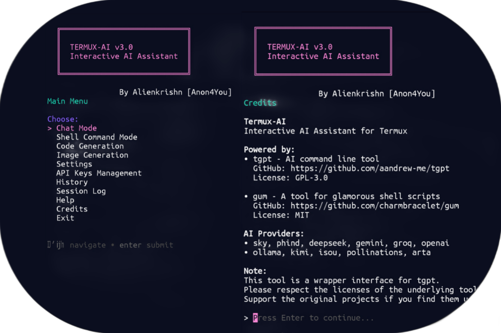

# Termux AI Assistant v4.0

> Interactive AI tool for Termux — a perfect wrapper around tgpt with 20+ chat providers, OpenAI-compatible endpoints, tool calling and image generation ✨



## ✨ Features

### 🤖 AI Modes
- **Chat**: Interactive conversations
- **Shell**: Generate terminal commands
- **Code**: Generate programming code
- **Web Search**: Find info via web search (`tgpt -f`)
- **Tool Calling**: Built-in tools like web search, file ops, shell execution (`tgpt -t`)
- **Images**: Create art with pollinations / magicstudio / anyapi

### 🔧 Management
- Secure API key storage
- Per-provider custom models
- Custom OpenAI-compatible endpoint support
- Session logging & conversation history
- Customizable settings

## 🎯 Menu Options

1. **Chat Mode** - Talk to AI
2. **Shell Mode** - Get commands
3. **Code Mode** - Generate code
4. **Web Search Mode** - Search the web
5. **Tool Calling Mode** - Model uses tools
6. **Image Mode** - Create images
7. **Settings** - Configure tool
8. **API Keys** - Manage keys
9. **History** - View past chats
10. **Session Log** - Current activity
11. **Help** - Documentation
12. **Credits** - Acknowledgments
13. **Exit** - Quit application

## 💎 Version 4.0

- **Default provider: powerbrain** (free, gpt-5 model, no API key)
- Updated for tgpt 2.14.0 — all current providers & flags
- **OpenAI-compatible**: point any OpenAI-style API (vLLM, LiteLLM, LocalAI, custom gateways)
- New **Web Search** and **Tool Calling** modes
- Per-provider model override
- Auto-migration of old configs (sky/phind/kimi → powerbrain)

## 🚀 Installation Methods

### ⚡ Quick Install (Recommended)
```bash
curl -sL https://is.gd/Termux_Ai | bash
```

### 📦 Repository Install (Auto-updates)
```bash
pkg install termux-ai
```
*Repo:* [TermuxVoid Repo](https://termuxvoid.github.io/)

## 🏆 Provider Details

### 🆓 Free Providers (no API key)
| Provider | Model | Features |
|----------|-------|----------|
| **PowerBrain** *(default)* | gpt-5 | Free, fast |
| **OpenCode** | deepseek-v4-flash-free | Free |
| **FX** | zai/glm-5.2 | Free |
| **aitopia** | gpt-4o-mini | Free |
| **isou** | Web Search | Web research |
| **pollinations** | Multiple | Chat + images |
| **deepseek-web** | DeepSeek | Free, needs userToken + node.js |
| **aihorde** | Community | Free, text + images |

### 🔑 API Key Providers
| Provider | Model | Key Required |
|----------|-------|--------------|
| **OpenAI** | GPT Series | API Key |
| **OpenRouter** | Many models | API Key |
| **Groq** | Llama Models | API Key |
| **Gemini** | Gemini Pro | API Key |
| **DeepSeek** | DeepSeek | API Key |
| **anyapi** | gpt-4o-mini | Free tokens |
| **AtlasCloud** | qwen3 | API Key |
| **litellm** | Gateway | API Key |
| **minimax** | MiniMax-M2.7 | API Key |
| **ollamacloud** | gpt-oss | API Key |

### 🖥️ Local / OpenAI-Compatible
| Provider | Model | Note |
|----------|-------|------|
| **Ollama** | Local models | Privacy |
| **OmniRoute** | auto | Local proxy |
| **Custom** | Any | Any OpenAI-compatible endpoint |

### 🎨 Image Generation
| Provider | Models | Features |
|----------|--------|----------|
| **Pollinations** *(default)* | flux, turbo | Free, custom size, output file |
| **magicstudio** | Various | Free, fast |
| **anyapi** | Many | Requires API key |

## 🤝 Credits

**Powered by:**
- [tgpt](https://github.com/aandrew-me/tgpt) - AI engine (v2.14.0)
- [gum](https://github.com/charmbracelet/gum) - UI framework

**AI Providers:** powerbrain, opencode, fx, aitopia, isou, pollinations, deepseek-web, aihorde, koboldai, ollama, omniroute, anyapi, atlascloud, deepseek, gemini, groq, litellm, minimax, ollamacloud, openai, openrouter

*Version 4.0 | No root required*